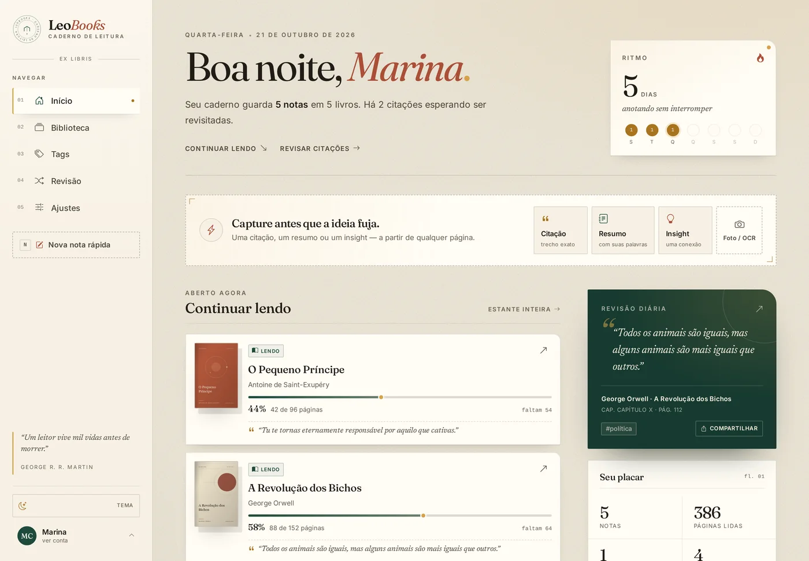
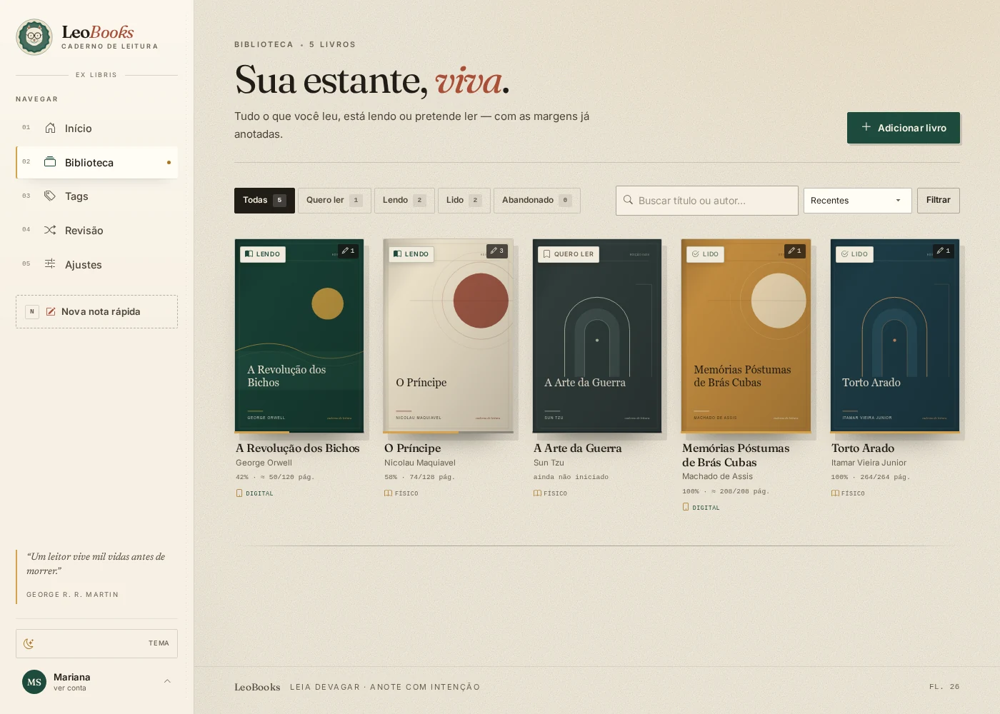
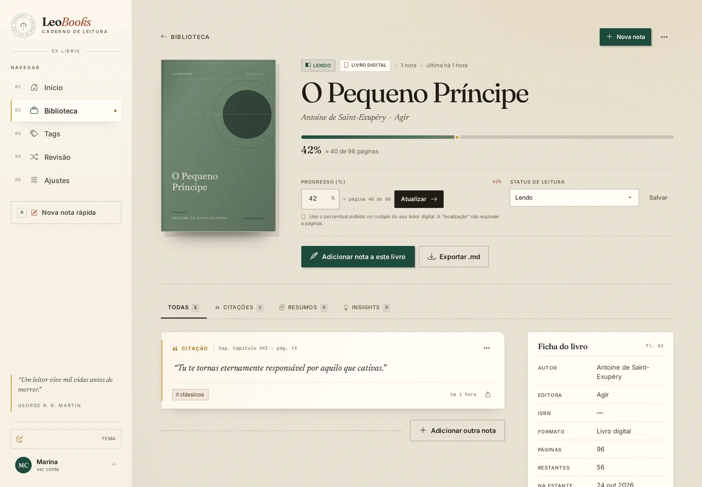
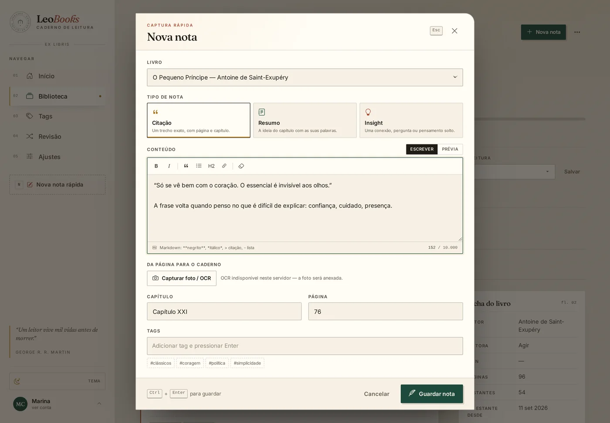
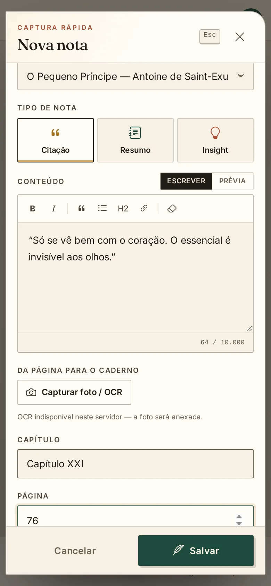
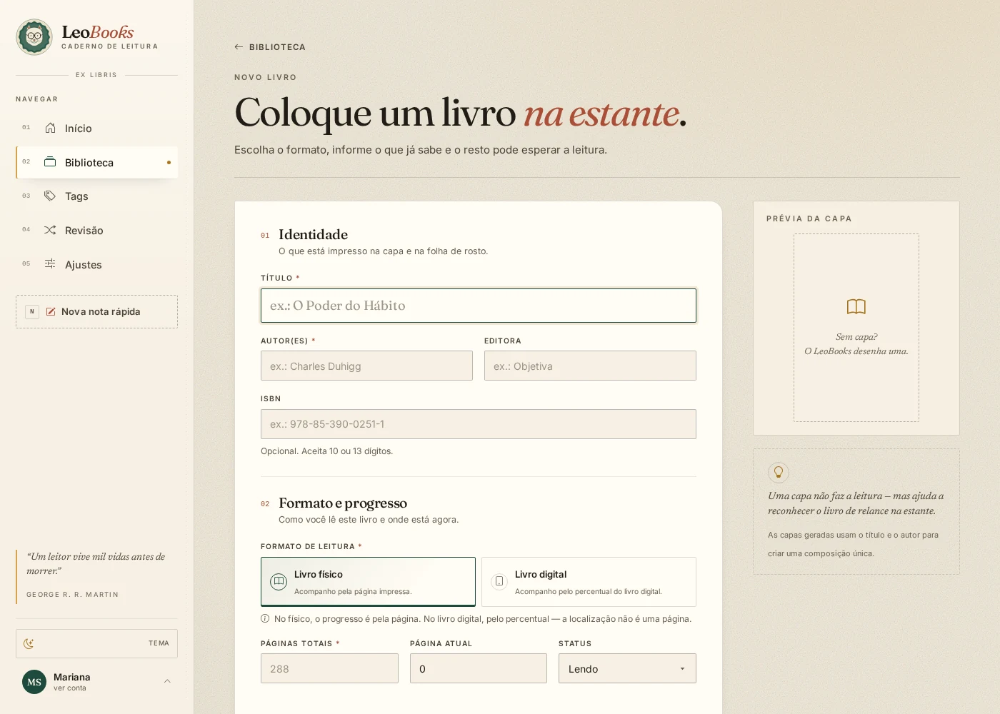

# LeoBooks

**Seu caderno de leitura.** Um lugar tranquilo para guardar citações, resumos e
ideias dos livros que você está lendo — com uma estante que parece um caderno,
não um painel de controle.

A seguir, a leitora fictícia **Mariana** atravessa uma semana usando o app:
uma edição de papel, uma citação no ônibus, um livro no Kindle e o backup de
domingo.



> As imagens abaixo usam uma conta fictícia e livros de exemplo. Nenhum dado
> real de leitor aparece nelas.

## Um lugar para as ideias que a leitura deixa

O LeoBooks reúne, em uma só tela, o livro que você está lendo, o trecho que
marcou e o pensamento que veio depois. Cada nota fica ligada à página, ao
capítulo e às tags que você escolher.

- **Estante visual** com capas, andamento e status de cada leitura.
- **Três tipos de nota:** citação, resumo e insight.
- **Formato físico ou digital**, cada um com sua própria forma de progresso.
- **Tags que atravessam livros**, busca sem acentos e revisão diária de citações.
- **Tema claro ou madrugada**, para ler e anotar em qualquer hora.
- **Seus dados no seu servidor**, com exportação e um backup completo em arquivo único.

## Veja o app

### Sua estante



### Cada livro, com suas margens



### Uma nota em poucos segundos



### No celular

<p align="center">
  
  
</p>

### E quando a noite chega


## Aplicativo para GNOME

Nas instalações nativas, o LeoBooks é um **aplicativo GTK**, não um atalho que
abre o navegador. O menu do GNOME inicia `leobooks`, que abre a interface em uma
janela GTK/WebKit e conversa com o serviço local em `127.0.0.1:5057`. O banco
continua sendo o SQLite em `/var/lib/leobooks`.

O pacote também instala metadados **AppStream** e capturas de tela, para que o
aplicativo apareça com nome, descrição e imagens no GNOME Software e na loja
da distribuição.

O servidor systemd continua existindo para que a janela tenha uma API local e
para permitir acesso pela LAN/Tailscale pelo navegador de outro dispositivo.

Em Debian/GNOME com Wayland, GPU virtual ou driver NVIDIA, o aplicativo força o
renderizador de software do WebKitGTK para evitar a tela preta. Para voltar a
testar a aceleração padrão, rode `WEBKIT_DISABLE_DMABUF_RENDERER=0
WEBKIT_DISABLE_COMPOSITING_MODE=0 leobooks`.

## Comece a usar

### Com Docker (recomendado)

Você só precisa de **Docker** e **Docker Compose** no servidor.

```bash
# dentro da pasta do projeto
# opcional: cp .env.example .env (para ajustar fuso, OCR e outros detalhes)
docker compose up -d --build
```

A porta **0.0.0.0:5059** já está definida no `docker-compose.yml`; não é preciso
criar `.env` para acessar pela LAN/Tailscale.

Abra **[http://127.0.0.1:5059](http://127.0.0.1:5059)** e crie sua conta.

Pronto. A primeira conta criada é a administradora do servidor. Na primeira
entrada, o LeoBooks apresenta um tutorial de cinco passos — você pode fazê-lo
ou clicar em **Pular tutorial**.

Se a imagem já estiver publicada no Docker Hub, também é possível baixá-la:

```bash
docker compose pull
docker compose up -d --no-build
```

O repositório configurado é
**[nickolback/leobooks](https://hub.docker.com/repository/docker/nickolback/leobooks)**.

### Sem Docker

Para rodar direto no computador ou servidor, com **Python 3.10+**:

```bash
python3 -m venv .venv
.venv/bin/pip install -r requirements.txt
./run.sh
```

Acesse **http://127.0.0.1:5057**.

Para parar, use `Ctrl+C`. Os dados ficam em `instance/`.

### Acessando pelo Tailscale

O LeoBooks escuta em `127.0.0.1` por padrão. Isso é bom para segurança, mas
significa que o IP do Tailscale (`100.x.y.z`) **não** alcança a porta. Para
acessar pelo tailnet, faça o bind na interface correta.

Descubra o IP da máquina:

```bash
tailscale ip -4
# exemplo: 100.x.y.z
TAILSCALE_IP="$(tailscale ip -4)"
```

**Execução local** — reinicie o serviço apontando para o IP do Tailscale:

```bash
pkill -f "waitress-serve.*5057"
LEOBOOKS_HOST="$TAILSCALE_IP" LEOBOOKS_PORT=5057 ./run.sh
```

Acesse `http://$TAILSCALE_IP:5057`. Se preferir aceitar também a LAN, use
`LEOBOOKS_HOST=0.0.0.0` e restrinja a porta no firewall/ACL.

**Com Docker** — a porta já está publicada diretamente no Compose como
`0.0.0.0:5059:5057`, sem precisar de variável de ambiente:

```bash
docker compose up -d --force-recreate
docker compose ps
```

A saída deve mostrar algo como
`0.0.0.0:5059->5057/tcp`. Teste do próprio servidor:

```bash
TAILSCALE_IP="$(tailscale ip -4)"
curl -I "http://$TAILSCALE_IP:5059/healthz"
```

E, de outro dispositivo no tailnet, abra
`http://100.x.y.z:5059`. Se precisar trocar a porta, edite a linha
`0.0.0.0:5059:5057` em `docker-compose.yml`.

> Use `http://`, não `https://`, enquanto `LEOBOOKS_HTTPS=0`. Se
> `LEOBOOKS_HTTPS=1` for usado em HTTP puro, o navegador não envia os cookies
> seguros e o login pode parecer quebrado.
>
> Se ainda houver timeout, confira `tailscale ping 100.x.y.z`, as ACLs do
> tailnet e o firewall da máquina. Para publicar um serviço local em HTTPS sem
> abrir porta, o Tailscale também oferece `tailscale serve` (consulte
> `tailscale serve --help`).

### O primeiro acesso

Ao criar a conta, você recebe um livro de exemplo — *A Arte da Guerra* — para
explorar. Ele não tem notas e pode ser excluído quando quiser começar a sua
própria estante.


O tutorial mostra a biblioteca, a captura rápida, o progresso de leitura e as
opções de dados. Ele pode ser **pulado** e revisto depois em
**Ajustes → Rever tutorial**.

## Mariana, uma leitora

> Mariana tem 37 anos, ensina história em Belo Horizonte e lê tanto em papel
> quanto no Kindle. Ela não quer transformar leitura em produtividade; quer
> conseguir voltar às passagens que a fizeram parar. O LeoBooks é o caderno que
> ela abre antes, durante e depois da leitura.
>
> A conta, os livros e as datas abaixo são fictícios. O percurso, porém, é o
> mesmo que qualquer leitor pode fazer.

### Domingo, 16h — *O Príncipe* entra na estante

Mariana chegou em casa com uma edição usada de *O Príncipe*. Em vez de anotar
o ISBN num papel que ela saberia que perderia, abriu o LeoBooks e foi em
**Biblioteca → Adicionar livro**.

Preencheu título e autor, escolheu **Livro físico** e deixou o status em
**Lendo**. Como a edição tinha ISBN, a busca de capas encontrou uma imagem; se
não encontrasse, o LeoBooks desenharia uma capa editorial e o caderno
continuaria funcionando offline.



Na estante, *O Príncipe* passou a dividir espaço com os livros de trabalho e de
prazer. A capa, o andamento e o status estavam ali — sem uma planilha, sem uma
lista infinita de metadados.

### Segunda, 7h40 — a citação no ônibus

No caminho para a escola, Mariana leu um trecho que queria guardar. Abriu
**Nova nota rápida** no celular, escolheu **Citação** e escreveu o trecho com
as próprias mãos, marcando o capítulo XXI e a página 74.

Antes de salvar, acrescentou duas tags: `#política` e `#clássicos`. Também
anexou uma foto da página. O OCR é opcional; naquele dia ele não estava
instalado, mas a foto ficou guardada normalmente.

O editor aceita Markdown. Mariana usa negrito para as ideias centrais, listas
para os argumentos e links para artigos que quer reler depois. A prévia mostra
como a nota ficará antes de ela guardar.


### Quarta, 22h — a leitura muda de formato

À noite, Mariana começou *A Revolução dos Bichos* no Kindle. Em **Adicionar
livro**, escolheu **Livro digital** e informou o percentual que aparecia no
aparelho: **42%**.

Ela não precisou inventar uma página. O total de páginas é opcional e serve
apenas para estimar a página equivalente. Se ela trocar de formato no meio da
leitura, pode editar o livro e converter o progresso existente.

Para Mariana, essa distinção importa: página impressa e porcentagem do leitor
digital são coisas diferentes. O LeoBooks trata cada uma com sua própria
mecânica, em vez de fingir que 42% são exatamente a página 84.

### Sexta, 19h — a frase volta

Naquela sexta-feira, Mariana lembrou de uma passagem para preparar uma aula. Abriu
a **Busca** e digitou `principe`, sem acento. O app encontrou *O Príncipe* no
título e a citação guardada na segunda-feira.

Ela também podia ter chegado pelo caminho das tags: `#política` mostrava o fio
que atravessava *O Príncipe*, *A Revolução dos Bichos* e outros livros. A
**Revisão** trouxe uma citação para reler. Mariana compartilhou a imagem com uma
colega; o arquivo foi salvo com livro, capítulo e página no nome:

```text
o-principe-capitulo-xxi-pagina-74-leobooks.png
```

### Sábado, 9h — tudo em ordem

No fim de semana, Mariana trocou o tema para **madrugada**, leu a citação do dia
no início e foi em **Ajustes → Dados e backup**. Como foi a primeira conta do
servidor, ela é administradora e pode baixar o backup completo.

O arquivo é único:

```text
leobooks_backup_AAAAMMDD_HHMMSS.zip
├── leobooks.db       # banco SQLite consistente
├── covers/           # capas
├── uploads/          # fotos das notas
└── manifest.json     # formato, contagens e checksums
```

Ela guarda o ZIP no HD externo e, se precisar, envia o mesmo arquivo em
**Restaurar backup**. O LeoBooks valida o conteúdo, as checksums e as referências
às imagens antes de trocar qualquer coisa. Se algo estiver corrompido, o estado
atual continua intacto; uma cópia de segurança fica em `instance/backups/` — ou,
na instalação nativa, em `/var/lib/leobooks/backups/`.

> O backup não inclui a chave de sessão: depois de restaurar, é preciso entrar
> novamente. Backups antigos em `.db` continuam aceitos, mas restauram apenas o
> banco; capas e fotos atuais são mantidas.

### O que o caminho da Mariana mostra

| O que ela precisa | Como o LeoBooks responde |
| --- | --- |
| Guardar o livro que está lendo | Estante visual com capa, status e progresso |
| Não perder a frase que a fez parar | Citação ligada à página, ao capítulo e às tags |
| Separar leitura em papel e digital | Progresso por página ou por percentual |
| Reencontrar uma ideia meses depois | Busca sem acentos, tags e revisão |
| Levar o caderno para outro lugar | Exportação Markdown/JSON e backup completo em ZIP |
| Ler de madrugada | Tema claro ou madrugada |

O que Mariana não encontra no LeoBooks também é proposital: feed, ranking de
leitura, notificações de produtividade e telemetria. O app foi feito para
guardar o que a leitura deixa, não para competir com ela.

## Perguntas frequentes

**Onde ficam meus dados?**
No servidor onde o LeoBooks está rodando. No Docker, ficam em um volume
persistente; sem Docker, em `instance/`. Não há envio para uma nuvem do
LeoBooks.

**Como atualizo o app?**
Com Docker:

```bash
docker compose pull
docker compose up -d --no-build
```

Se estiver compilando localmente:

```bash
docker compose build --pull
docker compose up -d
```

O volume com seus dados é preservado.

**Como apago tudo?**
Você pode excluir sua conta em **Ajustes → Excluir conta**. Para apagar também o
volume do Docker, use `docker compose down -v` — atenção: isso remove o banco,
as capas e todos os backups locais.

**Esqueci minha senha. E agora?**
O LeoBooks não envia e-mail de recuperação. Peça à conta administradora para
criar uma nova conta, ou remova o volume e comece de novo se for um ambiente de
testes.

**Funciona em leitores digitais?**
Use o navegador do celular ou computador; o app não é um aplicativo nativo de leitor digital. O progresso pode ser informado pela porcentagem exibida no aparelho.

**Preciso estar sempre conectado à internet?**
Não. O LeoBooks roda no seu servidor. A internet só é usada quando você pede
para buscar capas em bases públicas.

**Por que apareceu um livro que eu não cadastrei?**
É o livro de exemplo do primeiro acesso. Ele pode ser excluído normalmente em
**Biblioteca**.

## Privacidade

- Cada conta vê somente os próprios livros, notas, tags e imagens.
- Não há telemetria nem rastreadores de terceiros.
- A busca de capas envia apenas ISBN, título e autor para Open Library, Google
  Books e, como fallback, Goodreads. O conteúdo das suas notas nunca é enviado.
- Os logs de auditoria ficam no servidor e não registram senhas, tokens nem o
  conteúdo das notas.
- O backup completo contém todas as contas, capas e fotos; é restrito à administradora.

---

<details>
<summary><strong>Detalhes técnicos, Docker Hub e configuração avançada</strong></summary>

### Stack

Flask 3 + SQLite + Jinja + Bootstrap 5 local. Em produção, Waitress no modo
local ou Gunicorn no Docker (1 worker, 4 threads). Os assets de interface
(Bootstrap, ícones e fontes) são servidos localmente.

### Segurança

- CSRF em todos os formulários e requisições de escrita.
- Markdown convertido e sanitizado contra XSS.
- Senhas com hash Scrypt do Werkzeug.
- Uploads reescritos com Pillow, sem EXIF, servidos por rotas autenticadas.
- Busca de capas com allowlist de hosts, URLs assinadas e limite de tamanho.
- CSP, `X-Content-Type-Options`, `X-Frame-Options` e `Referrer-Policy`.
- Restauração de backup validada e restrita à administradora.

### Memória

O Compose aplica **`mem_limit: 512m`**. Medições no container:

| Cenário | Memória |
| --- | --- |
| Ocioso | ~65 MiB |
| 250 livros + 15.000 notas navegando pelo app | pico de ~203 MiB, sem OOM |

As consultas do dashboard e dos Ajustes usam contagens SQL, sem materializar
todas as notas. Imagens e OCR são processados um por vez para manter o pico
previsível.

### Logs

As ações principais geram linhas JSON de auditoria no `stdout`, com
`request_id`, usuário, IP e resultado. Senhas, tokens e conteúdo das notas não
são registrados.

O endpoint `/healthz` é chamado pelo Docker a cada **5 minutos** e é filtrado do
access log para não poluir o histórico. O resultado continua validando banco e
HTTP; erros de health aparecem no log de erro do container.

```bash
docker compose logs -f leobooks
```

### Variáveis principais

| Variável | Padrão | Para que serve |
| --- | --- | --- |
| `LEOBOOKS_PORT` | `5057` | Porta interna/local. |
| `LEOBOOKS_INSTANCE` | `instance/` no código | Diretório de dados em instalações nativas (`/var/lib/leobooks` nos pacotes). |
| `LEOBOOKS_SAMPLE_BOOK` | `1` | Cria o livro de exemplo em cada cadastro. |
| `LEOBOOKS_COVER_LOOKUP` | `1` | Liga/desliga a busca de capas. |
| `LEOBOOKS_IMAGE_TAG` | `latest` | Tag da imagem `nickolback/leobooks`. |
| `LEOBOOKS_HTTPS` | `0` | Ativa cookies seguros quando atrás de HTTPS. |
| `LEOBOOKS_LOG_LEVEL` | `INFO` | Nível dos logs. |
| `INSTALL_OCR` | `false` | Instala Tesseract na imagem (aumenta tamanho/memória). |

O arquivo [.env.example](.env.example) traz todas as opções comentadas.

### Instalação nativa: Debian, Fedora e Arch

O Docker continua sendo a opção recomendada para o homelab, mas o LeoBooks
também pode ser instalado como serviço systemd, sem container.

**Debian 13 / Ubuntu (amd64):**

```bash
sudo apt install ./dist/leobooks_1.0.3_amd64.deb
sudo systemctl status leobooks
```

O pacote instala o serviço, o **aplicativo GTK LeoBooks** no menu do GNOME, a
configuração em `/etc/leobooks/leobooks.env` e os dados persistentes em
`/var/lib/leobooks`. O atalho abre uma janela GTK/WebKit; não abre um navegador
externo.

**Fedora 42 (x86_64):**

```bash
sudo dnf install ./dist/leobooks-1.0.3-1.fc42.x86_64.rpm
# Em Fedora com yum (compatibilidade): sudo yum install ./dist/leobooks-1.0.3-1.fc42.x86_64.rpm
sudo systemctl status leobooks
```

**Arch e outras distros com Python 3 e systemd:**

```bash
tar -xzf dist/leobooks-1.0.3-linux-x86_64.tar.gz
cd leobooks-1.0.3
sudo ./install.sh
```

O instalador do tarball cria o venv no destino, então o alvo precisa de Python
3.10+, GTK 3/WebKitGTK 4.1 e acesso ao PyPI durante a instalação. Em Arch:

```bash
sudo pacman -S python-gobject gtk3 webkit2gtk-4.1
```

Em qualquer formato:

```bash
sudo nano /etc/leobooks/leobooks.env
sudo systemctl restart leobooks
```

Para acessar pela LAN/Tailscale, ajuste no arquivo:

```env
LEOBOOKS_BIND=0.0.0.0
```

A porta padrão é **5057**. Para remover preservando os dados, use
`apt remove leobooks`, `dnf remove leobooks` ou o `uninstall.sh` do tarball.
O `purge` do Debian também remove `/var/lib/leobooks`.

Gerar novamente os pacotes:

```bash
./packaging/build-deb.sh
./packaging/build-rpm.sh   # usa um container Fedora 42
./packaging/build-tarball.sh
```

Os artefatos são gerados em `dist/`, junto com `SHA256SUMS` e
`BUILD-INFO.txt`. O RPM é específico para Fedora 42 x86_64; para outra
versão/arquitetura, rebuilde no alvo correspondente. O registro de mudanças
fica em [CHANGELOG.md](CHANGELOG.md).

### Publicar a imagem no Docker Hub

O Compose já aponta para `nickolback/leobooks`:

```bash
docker login
docker compose build
docker compose push
```

Para uma release versionada:

```bash
LEOBOOKS_IMAGE_TAG=1.0.3 docker compose build
LEOBOOKS_IMAGE_TAG=1.0.3 docker compose push
```

O repositório é
https://hub.docker.com/repository/docker/nickolback/leobooks.

### Testes

```bash
.venv/bin/pip install -r requirements-dev.txt
.venv/bin/pytest -q
```

Estado atual: **105 testes passando** — rotas, CSRF, isolamento entre contas,
sanitização de Markdown, uploads, busca de capas, backup, tutorial e exclusão de
conta.

### Limites conhecidos

- Não há recuperação de senha por e-mail.
- OCR depende de Tesseract instalado e vem desligado por padrão.
- A exportação é Markdown/JSON; para PDF, use a impressão do navegador.
- A busca de capas depende de serviços externos e pode falhar; a capa gerada é
  o fallback.
- SQLite atende bem um servidor pessoal; para várias instâncias simultâneas,
  seria necessário migrar para PostgreSQL.

### Estrutura resumida

```text
app.py, routes.py, models.py, helpers.py, forms.py
utils/            Markdown, capas, imagens, OCR, auditoria
templates/        telas e componentes Jinja
static/           CSS, JS, fontes e Bootstrap local
tests/            suíte de testes
wireframe/        referências originais de design
```

</details>

---

Feito para ler devagar e anotar com intenção.
